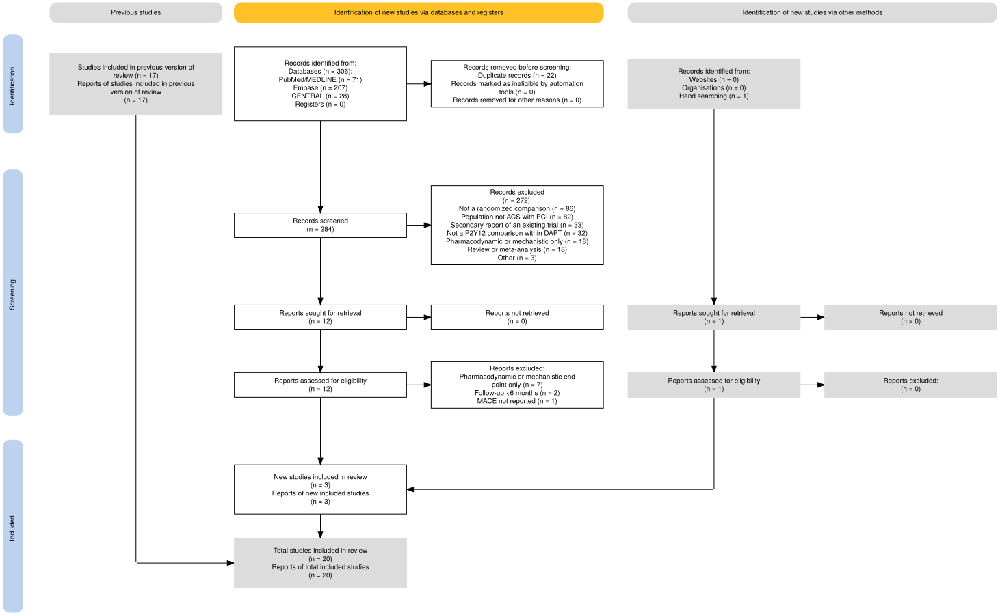
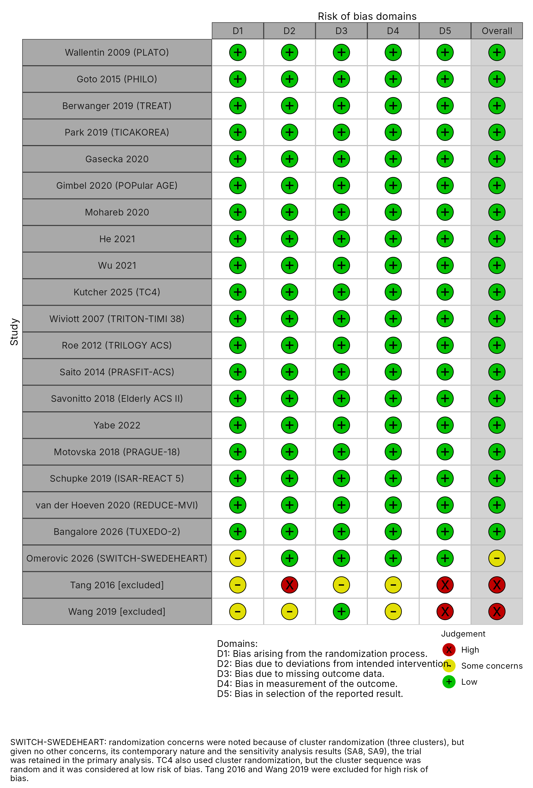

```{r setup}
#| include: false
suppressPackageStartupMessages({
  library(dplyr); library(tidyr); library(readr); library(stringr)
  library(ggplot2); library(glue); library(knitr)
})
root <- params$root
tdir <- file.path(root, "outputs", "tables", "oct")
fdir <- file.path(root, "outputs", "figures", "oct")
rd   <- function(f) read_csv(file.path(tdir, f), show_col_types = FALSE)
sa   <- rd("03_sensitivity_raw.csv")
sa9b <- rd("03b_sensitivity_bleed_sa9.csv")
mainr <- rd("02_main_results_raw.csv")
fe   <- rd("02b_fe_results.csv")
tau  <- rd("04_heterogeneity.csv")
loo  <- rd("06_loo.csv")
ns   <- rd("07_nodesplit_PT.csv")
conv <- rd("08_convergence.csv")
ssc  <- rd("00_switch_effective_counts.csv")
f2 <- function(x) formatC(x, format = "f", digits = 2)
pc <- function(x) paste0(round(100 * x), "%")
cm <- function(x) formatC(x, format = "d", big.mark = ",")
hrs <- function(m, l, h) glue("{f2(m)} ({f2(l)}–{f2(h)})")
lab <- c("T vs C" = "Ticagrelor vs clopidogrel", "P vs C" = "Prasugrel vs clopidogrel",
         "P vs T" = "Prasugrel vs ticagrelor")
prob_tbl <- function(d, first = "outcome") d |>
  mutate(Comparison = lab[comparison],
         `HR (95% CrI)` = hrs(median_HR, lo95_HR, hi95_HR),
         `Benefit` = pc(pr_clin_benefit), `Equivalence` = pc(pr_rope),
         `Harm` = pc(pr_clin_harm))
```

# Supplemental Appendix S1. Search strategy

We followed the same search strategy as in our previous Bayesian NMA [@BNMA2023]. The PubMed strategy is reproduced below. It was applied from the end of our previous search (August 2022) and translated for Embase (Ovid) and the Cochrane Central Register of Controlled Trials (CENTRAL).

1. (randomized controlled trial[pt] OR controlled clinical trial[pt] OR randomized[tiab] OR placebo[tiab] OR randomly[tiab] OR trial[tiab]) NOT (animals[mesh] NOT humans[mesh])     

2. ("acute coronary syndrome"[tiab] OR "acute coronary syndrome"[MeSH Terms] OR "myocardial infarction"[MeSH Terms] OR ( myocardial[tiab] AND infarction*[tiab] ) OR "acute mi"[tiab] OR "myocardial ischemia"[MeSH Terms] OR ( (myocardial[tiab] OR heart muscle[tiab]) AND isch*emi*[tiab] ) OR unstable angina[tiab] OR "angina, unstable"[MeSH Terms] OR STEMI[tiab] OR NSTEMI[tiab])      

3. "percutaneous coronary intervention*"[tiab] OR "percutaneous coronary revascularization*"[tiab] OR "percutaneous coronary revascularisation*"[tiab] OR "heart muscle revascularization*"[tiab] OR "heart muscle revascularisation*"[tiab] OR "percutaneous coronary intervention"[tiab:~3] OR PCI[tiab] OR "Percutaneous Coronary Intervention"[MeSH]     

4. stent*[tiab]. or Stents/      

5. coronary artery bypass*[tiab]. or Coronary Artery Bypass/     

6. #2 OR #3  OR #4 OR #5     

7. #6 AND ((clopidogrel[tiab] AND ticagrelor[tiab]) OR (clopidogrel[tiab] AND prasugrel[tiab]) OR (prasugrel[tiab] AND ticagrelor[tiab]))   

The PRISMA 2020 flow diagram is shown in Supplemental Figure S1.

{width=100%}

The updated search yielded 306 records (284 after de-duplication), and three new trials met the inclusion criteria (TUXEDO-2, TC4 and SWITCH-SWEDEHEART, the last identified by hand search), bringing the network to 20 trials.


# Supplemental Appendix S2. Risk-of-bias assessment

Trial-level Cochrane RoB 2 judgments are shown in Supplemental Figure S2.

{width=70%}

All included trials were judged at low risk of bias except SWITCH-SWEDEHEART (some concerns in the randomization domain only), whereas the two excluded trials were at high risk, chiefly because of selection of the reported result.


# Supplemental Appendix S3. Prior distributions

The between-study standard deviation $\tau$ was given a normal(0, 0.5) prior on the standard-deviation class, which brms constrains to be positive, giving a half-normal(0, 0.5) distribution. If $Z \sim \text{Normal}(0, 1)$, then

$$E[|Z|] = 2\int_0^\infty z \frac{1}{\sqrt{2\pi}} e^{-z^2/2}\,dz = \sqrt{2/\pi} \approx 0.798,$$

and for $X = \sigma Z$, $E[|X|] = \sigma\sqrt{2/\pi}$. With $\sigma = 0.5$ the prior mean of $\tau$ is about 0.40 on the log-HR scale. This implies study-specific true effects varying by roughly $\pm 0.78$ log-HR units around the population mean, a conservative (wide) choice relative to empirical heterogeneity in cardiovascular drug trials (typically 0.1–0.3) [@turner2012]. Prior predictive checks (Supplemental Figure S3) confirmed that the priors generate plausible annual event rates.

```{r s1}
#| fig-cap: "Supplemental Figure S3. Prior predictive check: annual MACE rates implied by the weakly informative priors."
f <- file.path(fdir, "s_01_prior_predictive.png")
if (file.exists(f)) include_graphics(f)
```

The priors are therefore weakly informative, ruling out only implausible values, and the posterior estimates were essentially unchanged when the prior scale on $\tau$ was halved or doubled (SA6 and SA7, Supplemental Table S2).

# Supplemental Appendix S4. Incorporation of SWITCH-SWEDEHEART

```{r ss}
crude <- tibble(outcome = c("MACE", "Bleeding"), cT = c("1113/9,444", "413/9,444"),
                cP = c("848/7,651", "321/7,651"), cOR = c("0.93 (0.85–1.03)", "0.96 (0.83–1.11)"))
# one row per quantity, one column per outcome (fits the page width)
ss_tab <- ssc |>
  left_join(crude, by = "outcome") |>
  transmute(outcome,
            `Crude events/patients, ticagrelor` = cT, `Crude events/patients, prasugrel` = cP,
            `Crude OR (95% CI)` = cOR,
            `Published adjusted OR (95% CI)` = as.character(glue("{f2(or)} ({f2(lo)}–{f2(hi)})")),
            `Design effect` = f2(design_effect),
            `Effective events/patients, ticagrelor` = as.character(glue("{r0}/{cm(n0)}")),
            `Effective events/patients, prasugrel` = as.character(glue("{r1}/{cm(n1)}"))) |>
  pivot_longer(-outcome, names_to = "Quantity") |>
  pivot_wider(names_from = outcome, values_from = value) |>
  select(Quantity, MACE, `Major bleeding` = Bleeding)
ss_tab |>
  kable(align = "lcc", caption = "Supplemental Table S1. SWITCH-SWEDEHEART: crude counts, published adjusted estimates and the effective counts used in the primary analysis.")
```

The design effect is the ratio of the variance of the adjusted log-OR, taken from the published 95% CI as $[(\ln U - \ln L)/(2 \times 1.96)]^2$, to the binomial variance $1/(n_0 p_0 q_0) + 1/(n_1 p_1 q_1)$ at the observed arm sizes. Here $p_0$ is the observed ticagrelor-arm risk and $p_1$ the prasugrel-arm risk implied by the adjusted OR. Effective counts are the arm sizes divided by the design effect, with events at risks $p_0$ and $p_1$. The investigators' prespecified sensitivity analyses gave MACE ORs of 0.82 to 0.94 [@switch2026]:

- cluster-period random effect: 0.90;

- alternative covariates: 0.90;

- log link (risk ratio): 0.91;

- time-varying policy effect: 0.87;

- complete case: 0.94;

- fixed cluster effects: 0.94;

- categorical time: 0.82;

- GEE: 0.88, although its interval is unreliable with three clusters.

The primary estimate lies in the middle of this range.

# Supplemental Appendix S5. Sensitivity analyses

```{r sa}
#| tbl-colwidths: [25, 24, 18, 10, 15, 8]
prob_tbl(sa) |>
  mutate(Model = if_else(comparison == "T vs C", outcome, "")) |>
  select(Model, Comparison, `HR (95% CrI)`, `Benefit`, `Equivalence`, `Harm`) |>
  kable(align = "llcccc", caption = "Supplemental Table S2. Sensitivity analyses for MACE (all models are random-effects cloglog with log(time) offset unless stated).")
```

SA1: logit (log-OR) model without time offset. SA2: PCI-only trials (excluding TREAT and TRILOGY ACS). SA3: excluding TC4. SA4: excluding TUXEDO-2. SA5: excluding PRAGUE-18. SA6: half-normal(0, 0.25) prior on $\tau$. SA7: half-normal(0, 1) prior on $\tau$. SA8: excluding SWITCH-SWEDEHEART. SA9: SWITCH-SWEDEHEART entered as crude counts. Benefit, Equivalence and Harm are the posterior probabilities that the HR is <0.90, 0.90 to 1.11, and >1.11, respectively; these definitions apply to Supplemental Tables S2, S3 and S5.

```{r sa9b}
#| tbl-colwidths: [25, 24, 18, 10, 15, 8]
bind_rows(mutate(filter(mainr, str_detect(outcome, "Bleeding")), Model = "Primary"),
          mutate(sa9b, Model = "SA9: crude counts")) |>
  prob_tbl() |>
  select(Model, Comparison, `HR (95% CrI)`, `Benefit`, `Equivalence`, `Harm`) |>
  kable(align = "llcccc", caption = "Supplemental Table S3. Major bleeding: primary analysis versus SA9 (SWITCH-SWEDEHEART crude counts).")
```

```{r s2}
#| fig-cap: "Supplemental Figure S4. Sensitivity analyses for MACE: posterior median HR and 95% credible interval for each model. Shaded band, region of practical equivalence (0.90–1.11)."
#| fig-width: 8
#| fig-height: 7
sa |>
  mutate(outcome = factor(outcome, levels = rev(unique(outcome))),
         comparison = factor(comparison, levels = c("T vs C", "P vs C", "P vs T"))) |>
  ggplot(aes(median_HR, outcome, colour = comparison)) +
  annotate("rect", xmin = 0.9, xmax = 1.11, ymin = -Inf, ymax = Inf,
           fill = "#4393C3", alpha = 0.12) +
  geom_vline(xintercept = 1, linetype = "dashed", colour = "grey40") +
  geom_pointrange(aes(xmin = lo95_HR, xmax = hi95_HR),
                  position = position_dodge(width = 0.6), size = 0.3) +
  scale_x_log10(breaks = c(0.7, 0.8, 0.9, 1, 1.11, 1.3)) +
  scale_colour_manual(values = c("T vs C" = "#C0392B", "P vs C" = "#2471A3",
                                 "P vs T" = "#1E8449"), name = NULL) +
  labs(x = "Hazard ratio (log scale)", y = NULL) +
  theme_bw(base_size = 11) + theme(legend.position = "bottom")
```

```{r sa-range}
#| include: false
rng <- function(cmp) { x <- sa$median_HR[sa$comparison == cmp]; glue("{f2(min(x))} to {f2(max(x))}") }
```

Across the primary analysis and the nine sensitivity analyses, the posterior median MACE HRs ranged only from `r rng("T vs C")` for ticagrelor versus clopidogrel, `r rng("P vs C")` for prasugrel versus clopidogrel and `r rng("P vs T")` for prasugrel versus ticagrelor, and no analysis changed the qualitative conclusions for MACE or major bleeding.

# Supplemental Appendix S6. Heterogeneity, model comparison, convergence and consistency

```{r tau}
tau |>
  transmute(Outcome, Parameter = lab[paste(Parameter, "vs C")],
            `Tau, median (95% CrI)` = glue("{f2(Median)} ({f2(lo95)}–{f2(hi95)})"),
            `Pr(tau > 0.10)` = pc(pr_gt_01), `Pr(tau > 0.30)` = pc(pr_gt_03)) |>
  kable(caption = "Supplemental Table S4. Posterior between-study standard deviations (log-HR scale).")
```

```{r fe}
#| tbl-colwidths: [25, 24, 18, 10, 15, 8]
bind_rows(mutate(filter(mainr, str_detect(outcome, "MACE")), Model = "Random effects (primary)"),
          mutate(fe, Model = "Fixed effect")) |>
  prob_tbl() |>
  select(Model, Comparison, `HR (95% CrI)`, `Benefit`, `Equivalence`, `Harm`) |>
  kable(align = "llcccc", caption = "Supplemental Table S5. MACE: random-effects (primary) versus fixed-effect model.")
```

By leave-one-out cross-validation, the random-effects model was preferred: elpd difference for the fixed-effect model `r formatC(min(loo$elpd_diff), format = "f", digits = 1)` (SE `r formatC(loo$se_diff[which.min(loo$elpd_diff)], format = "f", digits = 1)`). Maximum $\hat{R}$ across the main models was `r formatC(max(conv$rhat_max), format = "f", digits = 3)`, with `r sum(conv$divergences)` divergent transitions.

```{r ns}
ns |>
  mutate(Estimate = recode(estimate,
           direct = "Direct (5 head-to-head trials)",
           indirect = "Indirect (via clopidogrel trials only)",
           network = "Network (direct + indirect)",
           ratio_direct_indirect = "Ratio of direct to indirect HR"),
         `HR (95% CrI)` = hrs(median_HR, lo95_HR, hi95_HR)) |>
  select(Estimate, `HR (95% CrI)`) |>
  kable(caption = "Supplemental Table S6. Consistency of the prasugrel versus ticagrelor MACE comparison.")
```

```{r s6-summ}
#| include: false
rt <- ns[ns$estimate == "ratio_direct_indirect", ]
```

Overall, between-study heterogeneity was modest (posterior median $\tau$ `r f2(min(tau$Median))` to `r f2(max(tau$Median))`), the models converged well, and the direct and indirect evidence for prasugrel versus ticagrelor was consistent (ratio of direct to indirect HRs `r f2(rt$median_HR)`, 95% CrI `r f2(rt$lo95_HR)` to `r f2(rt$hi95_HR)`), supporting the random-effects network model as the primary analysis.

# References

::: {#refs}
:::
